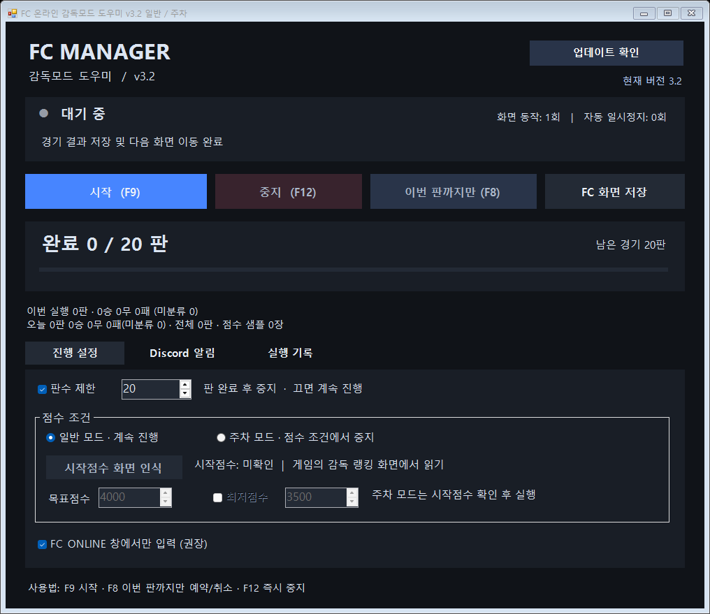
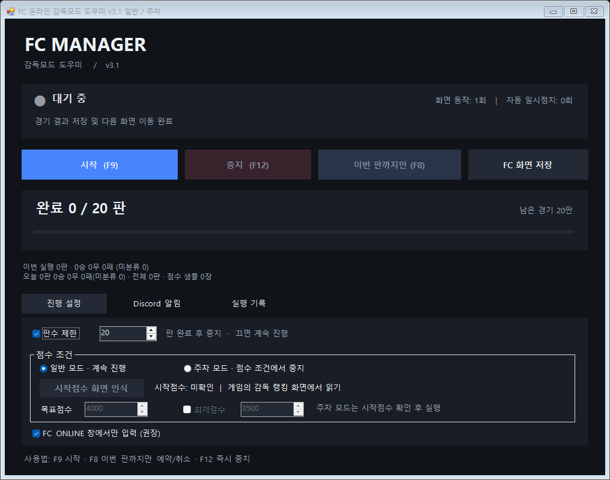

# FC Manager Assistant

FC 온라인 감독모드의 화면을 인식해 진행을 보조하는 Windows PowerShell 프로그램입니다.

## 최신 테스트 버전

**v3.2.11 훈련코치 모집 베타**

[**v3.2.11 프로그램 ZIP 다운로드**](releases/FC_Manager_v3.2.11_Coach_Recruit_Beta.zip)

- **훈련코치** 탭에서 조합 네 줄에 각 1~3개 특성을 선택할 수 있습니다. 빈 줄은 건너뛰고, 한 후보가 어느 한 줄의 특성을 모두 갖추면 순서에 관계없이 고용합니다. **조합 저장**으로 다음 실행에도 사용할 수 있습니다.
- 게임의 **훈련 코치 모집** 화면에서 **자동 모집 시작**을 누릅니다. 영상에서 확인한 A·B·C 각 한 칸의 3특성 후보와 새로 모집 50 CP, 고용 300 CP 화면을 지원합니다. 총 CP 한도는 실행당 적용되며 기본 300 CP에서는 현재 후보만 확인합니다. 예를 들어 800 CP는 새로 모집 최대 10회와 고용 1회에 해당합니다.
- Windows 한국어 OCR로 아이콘의 도움말 제목을 읽습니다. 특성을 확인하지 못하거나 확인창의 아이콘·비용이 다르면 중지합니다. 성공 안내를 확인하면 종료합니다. F12로 중지할 수 있습니다.
- 녹화 화면에서 확인창 판별과 아이콘 대조, 별도로 네 조합의 선택 및 저장과 CP 한도를 검사했습니다. Windows 게임의 전체 특성 OCR 및 실제 입력은 미검증입니다.

### v3.2.10 Discord 계정별 원격 조작 베타

[**v3.2.10 프로그램 ZIP 다운로드**](releases/FC_Manager_v3.2.10_Discord_Control_Beta.zip)

- 운영자가 Discord 앱과 원격 조작 서버를 설정한 뒤, 각 사용자는 **/연결**로 받은 개인 링크를 도우미의 **Discord 알림 → 원격 조작**에 한 번 입력합니다. [서버 설치와 계정 연결 안내](discord-control/README.md)
- 같은 서버에서도 **/상태**, **/시작**, **/이번판까지만**, **/중지**는 명령을 보낸 계정의 도우미에만 적용됩니다. **/연결해제**로 권한을 회수할 수 있습니다. PC와 도우미가 켜져 있어야 합니다.
- 로컬에서 서명 요청, 두 계정 분리, PowerShell 명령 수신 및 업데이트 설치를 검사했습니다. 실제 Discord와 Windows 게임을 함께 사용한 검증은 아직 진행하지 않았습니다.

### v3.2.9 BP 강화 보호 베타

[**v3.2.9 프로그램 ZIP 다운로드**](releases/FC_Manager_v3.2.9_BP_Protection_Beta.zip)

- FC 온라인 선수 강화 화면에서 대상을 선택한 뒤 도우미 상단의 **BP 강화 보호 100%** 버튼을 누르세요. 감독모드 자동 진행과 자동 시작 예약이 종료된 상태에서 사용할 수 있습니다.
- 도우미가 게임 창을 앞으로 가져와 보호 확률을 100%로 설정하고 **BP 보호 확률 값 유지**를 체크합니다. 준비 화면에서 초록색 **BP 강화 등급 보호 (100%)**를 확인하면 완료됩니다. 재료 선택과 강화 실행은 직접 진행합니다.
- F12로 중지할 수 있습니다. 다른 창이 선택되거나 화면을 확인할 수 없으면 중지합니다. 1920×1080 녹화본에서 인식 순서를 검사했고 실게임 입력은 미검증입니다.

### v3.2.8 점검 후 자동 시작 베타

[**v3.2.8 프로그램 ZIP 바로 다운로드**](https://github.com/Celaq/Fc-Manager-Assistant/raw/refs/heads/main/releases/FC_Manager_v3.2.8_Maintenance_Recovery_Beta.zip)

- 등급 변경 안내와 결과 화면에서 승급·강등을 판독해 Discord로 알립니다. Windows 한국어 OCR이 필요합니다.
- 진행 중 FC 온라인이 종료되거나 도우미가 비정상 종료되면 Discord로 알립니다.
- **자동 시작** 탭에서 한국 시간 기준 점검 종료 예정 시각을 예약할 수 있습니다. 도우미를 켜 둔 채 넥슨플러그에 로그인하고 FC 온라인 화면을 열어 두세요. 예약 시각 이후 활성화된 게임시작 버튼을 실행하고 감독모드 로비를 확인한 뒤 시작합니다.
- Linux에서 상태 전이, 종료 감시 및 배포 패키지를 검사했습니다. Windows 넥슨플러그와 실제 게임 화면 인식은 별도 확인이 필요합니다.

### v3.2.7 자동 복귀 · 대시보드 베타

[**v3.2.7 프로그램 ZIP 바로 다운로드**](https://github.com/Celaq/Fc-Manager-Assistant/raw/refs/heads/main/releases/FC_Manager_v3.2.7_Recovery_Dashboard_Beta.zip)

- 클럽 기부나 미션 허브 확인에 실패하면 Discord로 알리고 감독모드 로비 복귀를 시도합니다. 로비 복귀가 확인되면 기존 판수와 중지 예약을 유지합니다. 15초 안에 돌아오지 못하면 복귀 실패를 알리고 중지합니다.
- 확인된 승급·강등 결과를 경기당 한 번 Discord로 알립니다. Discord 알림 설정과 Windows 한국어 OCR이 필요합니다.
- 상단에서 현재 상태와 경기 진행률을 확인하고, 왼쪽 메뉴에서 진행 설정·일별 전적·Discord·실행 기록을 전환합니다.
- Linux에서 상태 전이와 배포 패키지를 검증했습니다. Windows 화면 표시, 실제 게임 입력과 등급 OCR은 별도 확인이 필요합니다.

### v3.2.6 일별 전적 베타

[**v3.2.6 프로그램 ZIP 바로 다운로드**](https://github.com/Celaq/Fc-Manager-Assistant/raw/refs/heads/main/releases/FC_Manager_v3.2.6_Daily_Stats_Beta.zip)

v3.2 이상은 앱의 **업데이트 확인** 버튼으로 설치할 수 있습니다.
자동 진행을 중지한 뒤 업데이트를 적용해 주세요.

- **일별 전적** 탭에서 한국 시간 기준으로 날짜별 총 경기, 승·무·패, 미분류 경기, 승률을 확인할 수 있습니다.
- 기존 전적은 저장된 경기 요약 및 결과 표본이 남아 있는 날짜에 한해 표시됩니다.
- 클럽 기부와 미션 허브 자동 확인: 한국 시간 23:30부터 자정 전까지 항목별 하루 1회.
- ‘다음 경기 후 기부·보상 확인’ 예약 버튼 추가.
- 경기 사이 미션 허브의 회색 수령 버튼을 실제 녹화로 확인했습니다. 시간 초과 시 Discord 알림을 켜 둔 경우 실패 단계를 보냅니다.
- 저장 화면 인식과 업데이트 설치를 검사했습니다. 실게임 조작은 미검증입니다.

다운로드가 시작되지 않으면 링크를 마우스 오른쪽 버튼으로 눌러 **새 탭에서 열기**를 선택해 주세요.

### v3.2 가독성 · 자동 업데이트

- 본문 글씨와 숫자 입력을 키우고 글자 대비·설정 간격을 개선했습니다.
- 시작 시 새 버전을 확인하며, 변경내용 확인 후 버튼으로 업데이트할 수 있습니다.
- 진행 중 설치 차단, ZIP/파일 해시 검증, 개인 설정·전적 보존, 실패 시 복구를 지원합니다.
- 3.1 이하에는 업데이트 기능이 없으므로 **이번 3.2는 새 폴더에 수동 설치**해 주세요. 이후 버전부터 앱 내 업데이트를 사용할 수 있습니다.
- 추가 게임/네트워크 오류창 59장 처리, 숫자 6 스코어 판독 및 짧은 하이라이트 반복에 대한 멈춤 오알림을 보완했습니다.
- 새 진단 점수 화면 946장, 기존 회귀검사, 설치·복구·별도 프로세스 재실행 검사를 통과했습니다.
- 실제 게임 입력과 다음 버전의 온라인 설치는 별도 확인이 필요합니다.
- [사용법 및 검증 범위](releases/FC_Manager_Assistant_v3.2_Test_Report.txt)

### v3.1 디자인 개편 · N판 진행

- 차콜 배경과 파란색 포인트, 큰 상태·진행 현황 및 설정/알림/로그 분리.
- 판수 제한을 켜고 1~9999판을 지정하면 이번 시작 이후 완료한 N판에서 중지합니다.
- 마지막 경기 결과를 저장하고 다음 화면을 넘긴 뒤 다음 경기 전에 중지합니다.
- 주차 점수 조건과 판수 조건 중 먼저 충족된 조건으로 중지하며, 재시작하면 새로 N판을 셉니다.
- 기존 회귀검사 814건과 새 기능·UI 검사 33건, 합계 847개 검사를 통과했습니다.
- 실제 게임에 입력하는 연속 경기 테스트는 미완료입니다. 새 폴더에 압축을 풀어 실행해 주세요.
- [사용법 및 테스트 결과](releases/FC_Manager_Assistant_v3.1_Test_Report.txt)

### v3.0.2 실행오류 수정 베타

- 레벨업 보상 및 네트워크 오류 확인창의 진행 처리를 추가했습니다.
- 경기 보상 다음 버튼을 일반 확인보다 우선 처리하고, 마우스 올림에 따른 녹색 밝기 변화를 보정했습니다.
- 숫자 3 판독 오류와 로비를 경기 결과로 잘못 집계하는 문제를 수정했습니다.
- 새 자료와 이전 자료에 대한 814개 검사 및 Windows PowerShell 5.1 UI 구성 검사를 통과했습니다.
- 실제 게임 입력·연결 복구 및 다른 해상도/배율은 미검증입니다. 기존 전적은 자동 보정하지 않습니다.
- [수정 및 테스트 결과](releases/FC_Manager_Assistant_v3.0.2_Test_Report.txt)를 확인하고 새 폴더에서 실행해 주세요.

### v3.0.1 실행오류 수정 베타

- 등급 변경 안내 및 승급·강등·잔류 결과 화면의 확인 버튼 처리를 추가했습니다.
- 챔피언스 아래 등급의 승점을 랭킹 점수 변화량으로 합산하던 오류를 수정했습니다.
- 랭킹 점수 화면으로 복귀하면 다음 경기 전에 로비 현재점수를 두 번 읽어 재확인합니다.
- `-67점` 판독을 보완하고 점수 판독 재시도 및 연속 확인을 추가했습니다.
- 제공된 보상 화면 48장과 강등·잔류 정체 화면 31장을 포함한 144개 검사 및 Windows PowerShell 5.1 UI 구성 검사를 통과했습니다.
- 실제 게임 조작, 승급 성공 화면, 등급 복귀 후 실제 로비 OCR 및 다른 해상도는 미검증입니다.
- [수정 및 테스트 결과](releases/FC_Manager_Assistant_v3.0.1_Test_Report.txt)를 확인하고 새 폴더에 압축을 풀어 실행해 주세요.

### v3.0 일반·주차 베타

- 일반 모드와 주차 모드를 구분하고 주차 모드에서는 화면 배경색을 바꿉니다.
- 챔피언스 랭킹 화면의 시작점수를 두 번 읽어 확인하고, 목표점수와 선택형 최저점수로 중지합니다.
- 경기 보상 점수 변동을 누적하며 읽을 수 없는 화면에서는 다음 경기 전에 중지합니다.
- 제공된 화면 67장에서 점수 숫자 판독을 시험했으며 Windows 실제 게임 테스트는 별도로 필요합니다.
- 자세한 사용법과 검증 범위는 ZIP 안의 TXT 파일을 확인해 주세요.

### v2.5.8 수정 사항

- 68경기 진단에서 확인된 S 표시 반복에 따른 잘못된 멈춤 알림 수정
- 경기 화면이 3분간 바뀌지 않은 경우에만 S 반복 관련 멈춤 알림
- 제공된 연속 진단 화면 70쌍과 정지 화면을 비교 검증. Windows 실제 게임 실행은 별도 확인 필요

### v2.5.7 수정 사항

- 경기 하이라이트 오른쪽 아래의 ESC 아이콘과 오른쪽의 밝은 SKIP 표시 영역을 함께 확인한 경우에만 Esc 입력
- 오인식으로 설정 화면이 열리지 않도록 탐색 위치를 제한
- 멈춤 알림 시 해당 화면을 진단 폴더에 자동 저장
- 제공받은 화면 8장 교차 검사 완료. Windows 실제 경기 동작은 별도 확인 필요

### v2.5.6 수정 사항

- S 안내 글자와 테두리만 비교해 변화하는 경기 배경 때문에 인식이 멈추는 문제 개선
- F8을 이번 판까지만 예약/취소 단축키로 적용하고 버튼에 표시
- 제공된 S 화면 1장과 다른 화면 7장에서 인식·오인식을 검사함 (실제 Windows 게임 조작 검증은 별도 필요)

### v2.5.5 수정 사항

- FHD 1920×1080 환경의 실제 FC 창 1296×759 진단자료 반영
- QHD/FHD를 실제 FC 창 크기에 맞춰 자동 보정
- 랭킹 화면을 Esc 안내로 오인식해 설정창이 열리던 문제 수정
- 자동 Esc 입력을 비활성화하고 S/Space 진행 경로만 사용
- 기본 마우스 입력이 거부되면 호환 클릭으로 자동 재시도
- 클릭 전후 대기시간을 추가해 FC 입력 안정성 개선

### v2.5.4 수정 사항

- v2.5.3 진단자료와 제공받은 2560×1440 원본 템플릿 반영
- 확대 화면에서 2560 템플릿을 자동 선택하도록 변경
- 유니폼 화면을 결과 화면의 `다음`으로 오인식해 판수를 잘못 집계하던 문제 수정
- 화면별 확대 인식 기준을 분리하고 일괄 허용값 제거
- S키 입력 시간을 늘리고 스캔코드 및 가상키 보강 입력 적용
- 로그에 사용한 1280/2560 템플릿 출처 표시

## 주요 기능

- 감독모드 화면 인식 기반 자동 진행
- 마스터·챔피언스·슈퍼챔피언스 공식경기 화면 지원
- 승·무·패 기록 및 점수 화면 자료 수집
- 챔피언스 등급 주차 베타: 목표점수·최저점수 중지
- `F8` 단축키로 **이번 판까지만 진행**
- 오류 발생 시 화면 앞쪽 알림
- Discord 웹훅 알림 지원

## 사용 방법

1. 위 ZIP 파일을 내려받아 새 폴더에 압축을 풉니다.
2. FC 온라인을 **1280×720 창모드**로 실행합니다.
3. FHD·QHD 모두 지원하며 실제 FC 창 크기를 기준으로 자동 보정합니다.
4. `Start_FC_Manager.cmd`를 실행합니다.
5. FC ONLINE 창을 선택한 뒤 `F9`를 눌러 시작합니다.
6. 현재 경기 종료 후 멈추려면 `F8`을 누릅니다.

## 문의 및 오류 제보

- 이메일: [xkzl134@gmail.com](mailto:xkzl134@gmail.com)
- 오작동이나 인식 실패가 발생하면 **오류확인용_보내기** 폴더를 압축해 첨부해 주세요.
- 개인 설정 및 Discord 웹훅 정보는 배포 ZIP에 포함되어 있지 않습니다.

## 주의

이 프로그램은 FC 온라인의 공식 프로그램이 아닙니다. 게임 운영정책 및 이용약관을 먼저 확인하시고, 사용에 따른 책임은 사용자에게 있습니다.
